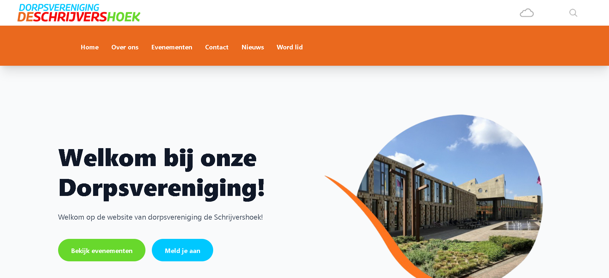

# Deepdive All Around

## Inhoudsopgave

- [Deepdive All Around](#deepdive-all-around)
    - [Inhoudsopgave](#inhoudsopgave)
    - [Versiebeheer](#versiebeheer)
    - [De Opdracht](#opdracht)
        - [Ons Doelen](#ons-doelen)
    - [Prototype / Product](#protoype--product)
    - [Voorbeeld van website](#voorbeeld-van-de-website)
    - [Over Ons](#over-ons)
        - [Wie zijn wij](#wie-zijn-wij)
        - [Verantwoordelijkheden](#verantwoordelijkheden)
        - [Contact opnemen](#contact-opnemen)
    - [Reflectie / Feedback](#reflectie--feedback)
        - [Reflectie](#reflectie)
        - [Feedback](#feedback)

## Versiebeheer

| Datum      | Versie | Wie      | Wijzigingen           |
| ---------- | ------ | -------- | --------------------- |
| 2026-11-16 | 1.0    | Kenji K. | Public Version        |
| 2026-11-17 | 1.1    | Kenji K. | Updated Docu          |
| 2026-11-17 | 1.2    | Kenji K. | Updated Inhoudsopgave |

## Opdracht

Wij hebben de opdracht gekregen van Occo om een website te maken voor **Dorpsvereniging Zuidbroek** voor hun 30 jarig bestaan. Ze waren toe aan een nieuwe website aangezien hun oude website erg verouderd was, en ze waren toe aan iets nieuws.

Voor 3 van ons is dit ons aller eerste project voor een Opdracht gever, best spannend dus.
Als je fouten in deze opdracht ziet laat het ons gerust weten en dan zullen we het zo spoedig mogelijk fixen!

Occo heeft ons uitgelegd dat het hele design van de website aan ons was waar onder:

- De huisstijl
- Het logo/wapen van de website (vereniging)
- De inrichting van de website

Dit hebben wij uitgewerkt tot alles wat je in deze repository vind!

### Ons Doelen

Wij hebben verschillende doelen opgesteld:

1. Doel van het project | Ons doel van het project was de opdrachtgever tevreden stellen, en te leren samenwerken met elkaar en dat is goed gelukt aangezien we gewonnen hebben!

2. Korte uitleg structuur | Wij hebben gebruik gemaakt van een structuur namelijk we begonnen met de NAV, daarna cards en op vervolg een subfooter en daarna en footer.

## Protoype / Product

1. Wat is er gerealiseerd : Wij hebben gerealiseerd dat samenwerken veel kan brengen, en goed teamwerk en heel mooi eindproduct als gevolgen kan hebben.

2. Wat is de kwaliteit van ons product: Wij hebben gewonnen, echter moesten we nog de hero op de homepage aanpassen en het wapen van Zuidbroek invoegen bij onze website.

3. Wat ontbreekt nog: Zoals eerder gezegd, het wapen en de hero op de homepage.

## Voorbeeld van de website

## Over Ons

### Wie zijn wij

Ons namen zijn Nathaniel Rigters, Kenji Kapteijn, David Kostwinder en Rik Franzen. Wij hebben tijdens deze deepdive gewerkt aan de nieuwe website voor Dorpsvereniging Zuidbroek voor de viering van hun dertig jarig bestaan.

### Verantwoordelijkheden

**Nathaniel Rigters**:

- Design
- (Deel) van de Front End

**Kenji Kapteijn**:

- Design
- (Deel) van de Front End

**David Kostwinder**:

- Wireframe
- Hulp met huisstijl bedenken

**Rik Franzen**:

- Design
- (Groot Deel) van de Front End

### Contact Opnemen

Als u contact met ons wilt opnemen kan dit via de onderstaande emails (Klik op de naam van degene waar je contact mee wilt opnemen)!

- [Nathaniel Rigters](mailto:nhwrigters@st.noorderpoort.nl)
- [Kenji Kapteijn](mailto:kkapteijn@st.noorderpoort.nl)
- [David Kostwinder](mailto:dokostwinder@st.noorderpoort.nl)
- [Rik Franzen](mailto:rfranzen@st.noorderpoort.nl)

## Reflectie / Feedback

Opdrachtgever: Occo ten Hoff

Coach: Wander van der Wal / Reygan Leito

### Reflectie

Ons enige kritiekpuntje is dat we volgende keer iets korter met het design bezig moeten en eerder moeten beginnen aan de webpagina zelf.

### Feedback

We zijn voornamelijk heel erg trots wat we deze deepdive hebben neergezet. Zelf hadden we niet verwacht dat we zouden winnen aangezien wij hadden gekozen voor een best unieke huisstijl met alle drukke vibrante kleuren.

Toch hebben we het gedaan en zijn we met een trots eindresultaat de deepdive uit gegaan.

Mocht u de eindversie met alle verwerkte feedback willen zien kunt u klikken op deze **[link](https://onszuidbroek.nl)**
Dankjewel voor het interrese tonen en het lezen van het verloop van ons project!
